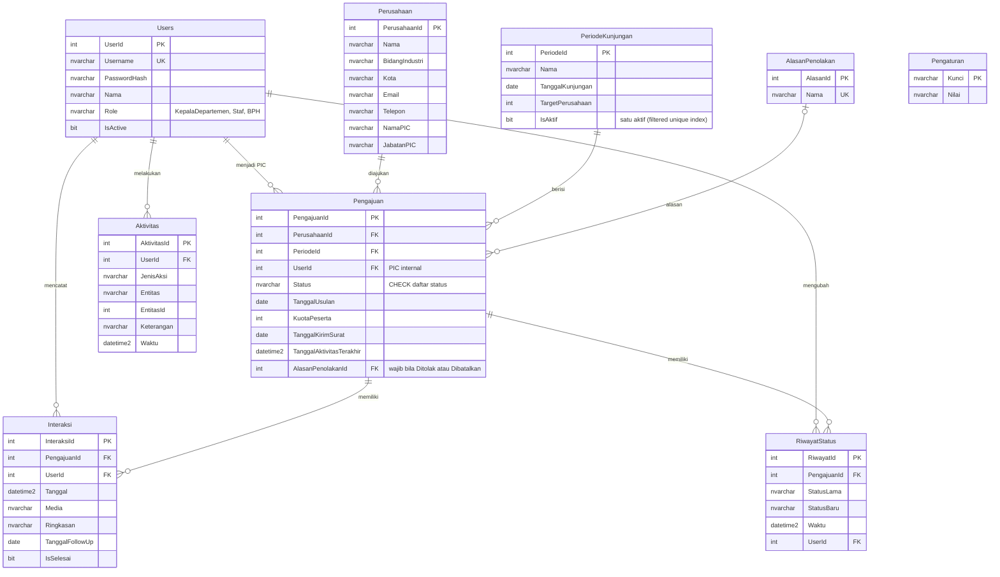

# ERD CompanyTrack_DB

Diagram ini ditulis dalam Mermaid. Pratinjau dapat dilihat di GitHub, VS Code (ekstensi Markdown Preview Mermaid), atau https://mermaid.live.

## Aturan integritas

| Aturan | Cara penegakan |
|---|---|
| Satu perusahaan hanya sekali per periode | `UNIQUE (PerusahaanId, PeriodeId)` pada Pengajuan |
| Hanya satu periode aktif | Filtered unique index `UX_Periode_Aktif` pada `IsAktif = 1` |
| Status hanya nilai yang dikenal | `CHECK` pada Pengajuan.Status |
| Ditolak dan Dibatalkan wajib beralasan | `CHECK CK_Pengajuan_Alasan` |
| Media komunikasi terbatas | `CHECK` pada Interaksi.Media |
| Hapus pengajuan ikut menghapus interaksi dan riwayat | `ON DELETE CASCADE` |
| Perusahaan yang punya pengajuan tidak bisa dihapus | FK tanpa cascade, dicek juga di service |

Follow-up terlambat dan balasan tertunda tidak punya kolom. Keduanya dihitung dari `Interaksi.TanggalFollowUp`, `Interaksi.IsSelesai`, dan `Pengajuan.TanggalAktivitasTerakhir`.
